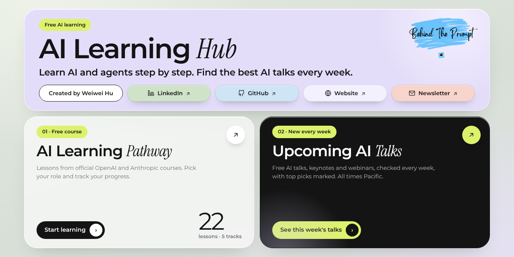

<a id="top"></a>

<p align="center">
  <a href="https://wei-wei-hu.github.io/ai-learning-path/"></a>
</p>

<h1 align="center">AI Learning Path</h1>

<p align="center"><strong>Free lessons · Official learning resources · Hands-on practice · Role-based tracks</strong></p>

<p align="center">
  <a href="./LICENSE"></a>
  <a href="#curriculum"></a>
  <a href="#five-tracks"></a>
  <a href="#how-this-course-is-built"></a>
  <a href="https://wei-wei-hu.github.io/ai-learning-path/"></a>
  <a href="./CONTRIBUTING.md"></a>
</p>

<p align="center">
  <a href="https://wei-wei-hu.github.io/ai-learning-path/"><strong>Start the interactive learning path →</strong></a>
</p>

<p align="center">Created by <a href="https://weiweihu.carrd.co/">Weiwei Hu</a> · <a href="https://weiweihu.carrd.co/">Website</a> · <a href="https://www.linkedin.com/in/weiweihu/">LinkedIn</a></p>


---

## Who this is for

This course is for anyone who wants to learn AI from the people building it. Choose **AI at Work** if you use AI in your job, **Management** if you run a team that works with AI, **AI Leadership** if you drive AI adoption and governance, **Engineering** if you design and build AI systems, and **Safety & Governance** if you are responsible for AI risk, security or compliance. Not sure? Start with AI at Work.

AI is moving quickly. The best learning resources are often scattered across documentation, research papers, tutorials, engineering blogs, and open-source repositories. Knowing where to start—and what to study next—can be harder than finding another tutorial.

**AI Learning Path** brings together selected, publicly available resources from **OpenAI and Anthropic** into a guided, 22-lesson curriculum. Learn how language models work, use APIs and tools, create agents, evaluate their performance, and deploy them responsibly.

Each lesson gives you official resources from both providers, a practical exercise, and questions to test what you learned. You can follow the full sequence or choose the lessons most relevant to your role.

**What makes this useful:** one learning sequence, two leading AI providers, and practical work you can apply to real projects.

## Your learning journey

| Stage | Lessons | What you can do afterward |
|---|---|---|
| [**1. Get started with AI**](./lessons/00-course-setup/README.md) | [Course Setup](./lessons/00-course-setup/README.md) · [AI Foundations](./lessons/01-ai-foundations/README.md) · [Prompting and Context](./lessons/02-prompting-and-context/README.md) · [AI Assistants and Agents at Work](./lessons/03-ai-assistants-and-agents-at-work/README.md) · [What Makes an Agent](./lessons/04-what-is-an-agent/README.md) | Use AI assistants well, write clear instructions, and know when an agent fits |
| [**2. Build AI applications**](./lessons/05-model-apis/README.md) | [Model APIs](./lessons/05-model-apis/README.md) · [Tool Use](./lessons/06-tool-use/README.md) · [Structured Outputs](./lessons/07-structured-outputs/README.md) · [Retrieval and RAG](./lessons/08-retrieval-and-rag/README.md) · [Multimodal](./lessons/09-multimodal/README.md) | Prototype apps that call models, use tools, return structured data and work with your documents |
| [**3. Build agents**](./lessons/10-agent-frameworks/README.md) | [Agent Frameworks](./lessons/10-agent-frameworks/README.md) · [Multi-Agent Systems](./lessons/11-multi-agent-systems/README.md) · [Memory and Context](./lessons/12-memory-and-context-engineering/README.md) · [MCP and Integrations](./lessons/13-mcp-and-integrations/README.md) · [Skills and Plugins](./lessons/14-skills-and-plugins/README.md) | Design and build agents with official SDKs, memory, MCP integrations and skills |
| [**4. Run advanced agents**](./lessons/15-coding-agents/README.md) | [Coding Agents](./lessons/15-coding-agents/README.md) · [Computer Use](./lessons/16-computer-use/README.md) · [Long-Running Agents](./lessons/17-long-running-and-managed-agents/README.md) | Supervise coding agents, computer use and long-running agents, and verify their work |
| [**5. Safety and governance**](./lessons/18-evaluating-ai-systems/README.md) | [Evaluating AI](./lessons/18-evaluating-ai-systems/README.md) · [Safety and Governance](./lessons/19-safety-security-and-governance/README.md) | Define quality checks, safeguards and governance before AI reaches real users |
| [**6. Lead and manage**](./lessons/20-managing-ai-enabled-teams/README.md) | [Managing AI-Enabled Teams](./lessons/20-managing-ai-enabled-teams/README.md) · [Leading AI Adoption](./lessons/21-leading-ai-adoption/README.md) | Redesign team workflows and plan organization-wide adoption |

These stages describe learning goals. Some exercises may require programming experience, API access, or paid usage. Every lesson is listed in the [Curriculum](#curriculum), and you can choose a [track](#five-tracks) to focus on your role.

<p align="right"><a href="#top">↑ Back to top</a></p>

## Five tracks

Every lesson is tagged with the tracks it serves, so you can take only what fits your role.

| Track | Who it is for |
|---|---|
| **AI at Work** | Anyone who uses AI in their job and wants better, more reliable results. The best place to start. |
| **Management** | Managers whose teams work with AI every day. Builds on AI at Work. |
| **AI Leadership** | People who lead AI adoption: transformation leads, AI champions and the executives who sponsor them |
| **Engineering** | Architects and engineers who design, build and run AI systems |
| **Safety & Governance** | Risk, compliance, security and governance teams, and anyone responsible for using AI safely |

The [Curriculum](#curriculum) shows which tracks each lesson belongs to. The [interactive site](https://wei-wei-hu.github.io/ai-learning-path/) turns each track into a step-by-step path with progress tracking.

<p align="right"><a href="#top">↑ Back to top</a></p>

## Curriculum

<!-- CURRICULUM:START -->
| # | Lesson | What you'll learn | Tracks |
|---|---|---|---|
| 00 | [Course Setup](./lessons/00-course-setup/README.md) | How the course works, the five tracks, and the free accounts you need | `AI at Work` `Management` `AI Leadership` `Engineering` `Safety & Governance` |
| 01 | [AI Foundations](./lessons/01-ai-foundations/README.md) | How language models work, what they do well, and where they fail | `AI at Work` `Management` `AI Leadership` `Engineering` `Safety & Governance` |
| 02 | [Prompting and Context](./lessons/02-prompting-and-context/README.md) | Write instructions models follow reliably, and give them the right context | `AI at Work` `Management` `AI Leadership` `Engineering` |
| 03 | [AI Assistants and Agents at Work](./lessons/03-ai-assistants-and-agents-at-work/README.md) | Use ChatGPT and Claude for real work with your own files, and hand off multi-step tasks you can check | `AI at Work` `Management` `AI Leadership` |
| 04 | [What Makes an Agent](./lessons/04-what-is-an-agent/README.md) | Workflows versus agents, and when an agent is worth building | `AI at Work` `Management` `AI Leadership` `Engineering` `Safety & Governance` |
| 05 | [Working with the Model APIs](./lessons/05-model-apis/README.md) | Call models from code with the Responses API and the Messages API | `Engineering` |
| 06 | [Tool Use and Function Calling](./lessons/06-tool-use/README.md) | Let models call your code, search the web and act on real systems | `Engineering` |
| 07 | [Structured Outputs](./lessons/07-structured-outputs/README.md) | Generate schema-constrained JSON and handle validation failures | `Engineering` |
| 08 | [Retrieval and Agentic RAG](./lessons/08-retrieval-and-rag/README.md) | Ground answers in your own documents and data | `Engineering` |
| 09 | [Multimodal: Vision, Audio and Voice](./lessons/09-multimodal/README.md) | Work with images, speech and real-time voice | `Engineering` |
| 10 | [Agent Frameworks: OpenAI Agents SDK and Claude Agent SDK](./lessons/10-agent-frameworks/README.md) | Build your first agent with each provider's official SDK | `Engineering` |
| 11 | [Multi-Agent Systems and Orchestration](./lessons/11-multi-agent-systems/README.md) | Handoffs, subagents and when splitting work across agents helps | `Engineering` |
| 12 | [Memory and Context Engineering](./lessons/12-memory-and-context-engineering/README.md) | Keep agents on track across long tasks and many sessions | `Engineering` |
| 13 | [Model Context Protocol and Integrations](./lessons/13-mcp-and-integrations/README.md) | Connect AI to your tools and data through the open MCP standard | `Engineering` |
| 14 | [Skills and Plugins](./lessons/14-skills-and-plugins/README.md) | Package know-how so any agent can reuse it | `AI at Work` `Management` `Engineering` |
| 15 | [Coding Agents: Codex and Claude Code](./lessons/15-coding-agents/README.md) | Delegate real software work and verify the results | `AI Leadership` `Engineering` |
| 16 | [Computer Use and Browser Agents](./lessons/16-computer-use/README.md) | Agents that operate screens, browsers and apps | `Engineering` `Safety & Governance` |
| 17 | [Long-Running and Managed Agents](./lessons/17-long-running-and-managed-agents/README.md) | Run agents for hours in hosted harnesses and sandboxes | `Engineering` |
| 18 | [Evaluating AI Systems](./lessons/18-evaluating-ai-systems/README.md) | Prove quality with evals before and after you ship | `Management` `AI Leadership` `Engineering` `Safety & Governance` |
| 19 | [Safety, Security and Governance](./lessons/19-safety-security-and-governance/README.md) | Guardrails, oversight and what frontier research teaches about risk | `AI Leadership` `Engineering` `Safety & Governance` |
| 20 | [Managing AI-Enabled Teams](./lessons/20-managing-ai-enabled-teams/README.md) | Redesign team workflows, set review standards and coach people as AI takes on more of the work | `Management` |
| 21 | [Leading AI Adoption](./lessons/21-leading-ai-adoption/README.md) | Strategy, roadmaps and helping a whole organization use AI well | `AI Leadership` |
<!-- CURRICULUM:END -->

<p align="right"><a href="#top">↑ Back to top</a></p>

## How this course is built

- **Official sources only.** Every link goes to OpenAI or Anthropic: their academies, docs, cookbooks, blogs, research pages or GitHub organizations.
- **Maintained.** A GitHub Action checks every link each week and opens an issue when one breaks. All resources were selected and verified in November 2026.

## Run it locally

```bash
git clone https://github.com/wei-wei-hu/ai-learning-path.git
cd ai-learning-path
python3 scripts/build.py      # rebuild lessons, README tables and site data
open docs/index.html          # or serve the docs/ folder with any static server
```

## Contributing

Found a broken link, a newer official resource, or a better exercise? Contributions are welcome. Please read [CONTRIBUTING.md](./CONTRIBUTING.md) first; the main rule is that every resource must come from an official OpenAI or Anthropic source. By contributing, you agree to the contribution terms in the [LICENSE](./LICENSE).

## About the author

Created by **Weiwei Hu** · [Website](https://weiweihu.carrd.co/) · [LinkedIn](https://www.linkedin.com/in/weiweihu/) · [GitHub](https://github.com/wei-wei-hu)

Strategy and transformation leader focused on applying AI to business decisions, everyday workflows, and measurable outcomes.

If you find the learning path useful, **star the repository** to help others discover it. You can also share an improvement through [CONTRIBUTING.md](./CONTRIBUTING.md) or [connect on LinkedIn](https://www.linkedin.com/in/weiweihu/).

## Disclaimer

This is an independent learning guide. It is not affiliated with, endorsed by, or sponsored by OpenAI or Anthropic. All product names, logos and brands belong to their respective owners, and all linked material remains the property of its publishers.

## License

**Copyright © 2026 Weiwei Hu. All rights reserved.**

You may read and use this course for your own personal, non-commercial learning, share links to it, and quote short excerpts with credit to "Weiwei Hu, AI Learning Path" and a link to this repository.

Without prior written permission, you may **not** copy, republish or redistribute this course; modify, translate or create derivative courses or materials from it; use it for any commercial purpose, including paid training or consulting; remove the author's attribution; or use it to train or evaluate AI models.

Contributions are welcome under the terms in [LICENSE](./LICENSE). Linked OpenAI and Anthropic material belongs to its owners and is not covered by this license. For permission requests, contact [Weiwei Hu on LinkedIn](https://www.linkedin.com/in/weiweihu/).